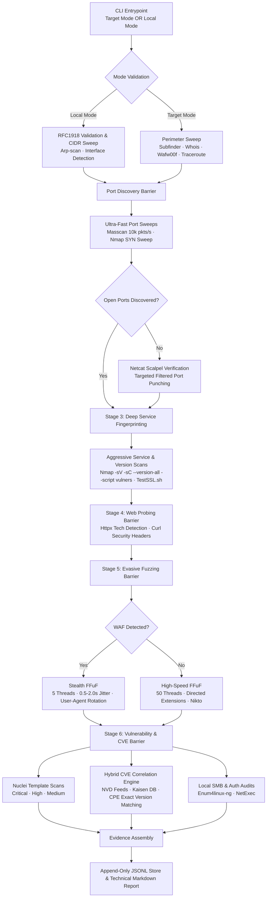

<div align="center">

# BlackHole

**An asynchronous, aggressive offensive reconnaissance orchestrator and attack surface engine written purely in Rust.**

**Zero stubs. Zero bloat. Non-blocking DAG execution.**

[Install](#install) · [Uninstall](#uninstall--clean-reinstall) · [Quick start](#quick-start) · [Command reference](#command-reference) · [How a scan runs](#how-a-scan-runs) · [Weapons Arsenal](#the-weapons-arsenal) · [Hybrid CVE Engine](#hybrid-cve-engine) · [Output](#output--evidence-store)

</div>

---

BlackHole acts as a gravitational sink for industry-standard cybersecurity binaries. Rather than reinventing flawed protocol stacks, it orchestrates proven security tools (Nmap, Masscan, Subfinder, Dnsx, FFuF, Nuclei, TestSSL, Nikto, NetExec, Enum4linux-ng) into a high-performance Directed Acyclic Graph (DAG) powered by `tokio`. Raw XML and JSON streams are deeply parsed in real time and persisted into an append-only JSONL Evidence Store, culminating in a structured technical assessment report.

> [!IMPORTANT]
> **Kali Linux & Root Privileges Required.** BlackHole utilizes low-level networking primitives (raw SYN packet streams via Masscan/Nmap, ARP sweeps, ICMP routing checks) and enforces execution from its root project directory to ensure environment integrity and dependency discovery.

---

## ▍Why BlackHole

<dl>

<dt>Aggressive Orchestration over Reinvention</dt>
<dd>Standard tools are fast and reliable when invoked correctly. BlackHole executes them in parallel, enforces sub-process sandboxing with <code>kill_on_drop(true)</code> and strict timeouts, and eliminates fragile terminal output by parsing raw XML and JSON streams directly.</dd>

<dt>Asynchronous DAG Execution Pipeline</dt>
<dd>Eliminates sequential bottlenecks. Probes without interdependencies execute concurrently inside a <code>tokio::task::JoinSet</code>, controlled by a global permit <code>Semaphore</code>. Synchronization barriers guarantee that dependent probes (such as service fingerprinting or web fuzzing) only launch once prerequisites (open ports and responsive hosts) are confirmed.</dd>

<dt>Adaptive WAF Evasion & Active Jitter</dt>
<dd>Detects Web Application Firewalls (Cloudflare, AWS WAF, Akamai, Imperva) during initial sweeps and immediately downshifts aggressive fuzzers. FFuF automatically throttles from 50 threads down to 5 threads with 0.5s–2.0s randomized inter-request delay, rotates real browser User-Agents (Chrome, Firefox, Safari, Edge, Googlebot), and routes traffic through SOCKS5/HTTP proxies.</dd>

<dt>Strict Two-Mode Security Boundary</dt>
<dd>Separates external offensive sweeps from internal network audits. <code>target</code> audits domains or public IPs. <code>local</code> automatically discovers active LAN interfaces and enforces strict RFC1918 validation: scanning public IP ranges in local mode triggers an immediate safety abort.</dd>

<dt>Hybrid CVE Correlation Engine</dt>
<dd>Features an in-memory O(1) indexed vulnerability matcher. Cross-references Nmap-discovered CPE banners against NIST NVD feeds, Kaisen Linux databases, and built-in critical signatures, scoring confidence by version specificity (0.95 for exact versions, 0.70 for vendor/product families).</dd>

</dl>

---

## ▍Install

BlackHole provides an automated setup script that verifies administrative permissions, updates repositories, installs all binary dependencies via `apt-get`, configures the Rust stable toolchain via `rustup`, and builds the optimized release binary.

```bash
# Clone the repository
git clone https://github.com/Nostraxiten/BlackHole.git
cd BlackHole

# Grant execution rights and run the installer
chmod +x install.sh uninstall.sh
sudo ./install.sh
```

The script will automatically compile BlackHole and link the executable directly into the project root:

```console
[*] Initiating BlackHole environment setup and dependency verification...
[+] Privileges verified.
[*] Updating package repositories...
[*] Installing required binary utilities and build dependencies...
[+] Rust toolchain verified.
[*] Compiling BlackHole in release mode (aggressive optimizations)...
[+] Binary successfully compiled at: target/release/blackhole
[+] Local executable link created: ./blackhole
```

### ▍Uninstall & Clean Reinstall

To remove build artifacts, clear session evidence, or perform a total system purge:

```bash
# Basic workspace cleanup (removes target/, Cargo.lock, and ./blackhole_output/)
./uninstall.sh

# Complete purge (removes BlackHole artifacts and uninstalls all apt dependencies)
sudo ./uninstall.sh --purge-deps

# Deep purge (removes BlackHole, dependencies, and purges the Rust compiler toolchain)
sudo ./uninstall.sh --purge-deps --purge-rust
```

---

## ▍Quick start

```bash
# External Target Audit: Comprehensive domain assessment
sudo ./blackhole scanme.nmap.org

# External Audit with Tor / SOCKS5 Proxy Routing & High Concurrency
sudo ./blackhole target.com --proxy socks5://127.0.0.1:9050 -c 16

# External Audit with NVD Feed Update and Custom Wordlist
sudo ./blackhole target.com --update-db -w /usr/share/wordlists/dirb/common.txt

# Local LAN Audit: Automatic active interface and RFC1918 subnet discovery
sudo ./blackhole local

# Local LAN Audit: Explicit private CIDR targeting
sudo ./blackhole local 192.168.1.0/24

# Local LAN Audit: Specific internal workstation assessment
sudo ./blackhole local 10.0.0.15
```

> [!TIP]
> Run `./blackhole --help` for flag summaries, or review the detailed section breakdowns below.

---

## ▍How a scan runs

BlackHole executes a multi-stage dependency pipeline. At each stage barrier, completed probe results update the central `AuditContext` snapshot before subsequent dependent probes are dispatched.



---

## ▍Command reference

<details>
<summary><b>Operational Modes & Target Selection</b></summary>

<br>
<dl>

<dt><code>blackhole &lt;TARGET&gt;</code></dt>
<dd>Initiates an <b>External Target Audit</b> against a domain or public IP. Performs passive reconnaissance, OSINT domain enumeration, multi-source DNS sweeps, aggressive port scans, web auditing, and CVE correlation.</dd>

<dt><code>blackhole local [SUBNET]</code></dt>
<dd>Initiates an <b>Internal LAN Audit</b>. If no subnet is supplied, BlackHole automatically inspects the default gateway and active interfaces to discover the local RFC1918 CIDR. Dispatches <code>arp-scan</code> and local SMB auditing probes (Enum4linux-ng, NetExec).</dd>

<dt><i>RFC1918 Safety Enforcement</i></dt>
<dd>In <code>local</code> mode, BlackHole verifies that every target IP and resolved hostname strictly resides within private ranges (<code>10.0.0.0/8</code>, <code>172.16.0.0/12</code>, <code>192.168.0.0/16</code>, <code>127.0.0.0/8</code>, <code>169.254.0.0/16</code>). Passing a public IP to <code>local</code> mode immediately halts execution.</dd>

</dl>
</details>

<details>
<summary><b>Concurrency, Limits & Timing Controls</b></summary>

<br>
<dl>

<dt><code>-c &lt;n&gt;</code> &nbsp;<sub><code>--concurrency</code></sub></dt>
<dd>Maximum concurrent probe executions governed by the global Tokio <code>Semaphore</code>. Defaults to <code>8</code> simultaneous permits to prevent local socket exhaustion and router table overflow.</dd>

<dt><code>-v</code> &nbsp;<sub><code>--verbose</code></sub></dt>
<dd>Enables verbose debug tracing output across all orchestrated tasks, capturing low-level socket diagnostics and parser states.</dd>

</dl>
</details>

<details>
<summary><b>Evasion, Routing & Proxy Configuration</b></summary>

<br>
<dl>

<dt><code>-p &lt;url&gt;</code> &nbsp;<sub><code>--proxy</code></sub></dt>
<dd>Routes all compatible outbound probe traffic through an upstream proxy. Accepts SOCKS5 and HTTP proxy endpoints (e.g., <code>socks5://127.0.0.1:9050</code> or <code>http://127.0.0.1:8080</code>). Automatically applies <code>-x</code> to FFuF, <code>--proxy</code> to Curl and Gobuster, <code>-http-proxy</code> to Httpx, and <code>-useproxy</code> to Nikto.</dd>

<dt><i>Adaptive Rate Limiting</i></dt>
<dd>When <code>WafDetectProbe</code> flags an active firewall, BlackHole dynamically reconfigures directory fuzzing engines:
<ul>
  <li><b>Unshielded Targets</b>: FFuF runs at maximum aggressiveness (50 threads).</li>
  <li><b>Shielded Targets</b>: FFuF drops to 5 threads and injects randomized inter-request sleep intervals (0.5s–2.0s) to bypass request rate thresholds.</li>
</ul>
</dd>

<dt><i>Browser Signature Rotation</i></dt>
<dd>Picks randomized User-Agents from a static pool of real-world desktop signatures (Chrome 124, Firefox 125, Safari 17, Edge 124, Googlebot 2.1) on every HTTP request.</dd>

</dl>
</details>

<details>
<summary><b>Wordlists & Targeted Fuzzing</b></summary>

<br>
<dl>

<dt><code>-w &lt;path&gt;</code> &nbsp;<sub><code>--wordlist</code></sub></dt>
<dd>Path to custom external dictionary for web fuzzing. If omitted or invalid, BlackHole falls back to its embedded internal dictionary containing 100+ high-value administrative, configuration, and API endpoints.</dd>

<dt><i>Directed Extensions</i></dt>
<dd>FFuF automatically fuzzes critical asset extensions alongside bare directories: <code>.php</code>, <code>.bak</code>, <code>.env</code>, <code>.git</code>, <code>.sql</code>, <code>.zip</code>.</dd>

</dl>
</details>

<details>
<summary><b>Vulnerability Feeds & Databases</b></summary>

<br>
<dl>

<dt><code>--update-db</code></dt>
<dd>Fetches the latest official National Vulnerability Database (NVD) JSON gzip feed directly from NIST, decompresses it in memory, and caches it locally at <code>./blackhole_output/nvd/nvdcve-recent.json</code> prior to initiating the assessment.</dd>

<dt><code>--kaisen-db &lt;path&gt;</code></dt>
<dd>Explicitly points to an external Kaisen Linux vulnerability database file (JSON array or mapped structure). If omitted, BlackHole automatically inspects candidate paths (<code>./kaisen/kaisen.db</code>, <code>./kaisen/db.json</code>, <code>~/.blackhole/kaisen.db</code>).</dd>

</dl>
</details>

<details>
<summary><b>Output & Artifact Destinations</b></summary>

<br>
<dl>

<dt><code>-o &lt;dir&gt;</code> &nbsp;<sub><code>--output</code></sub></dt>
<dd>Output directory path for persisted artifacts. Defaults to <code>./blackhole_output</code>. Generates real-time JSONL evidence logs, an executive technical Markdown report, and machine-readable JSON summaries.</dd>

</dl>
</details>

---

## ▍The Weapons Arsenal

BlackHole orchestrates 15 industry-standard binaries, invoking them with optimized parameters and parsing their structured outputs:

| Tool | Category | Standard Invocation Profile | Parsed Evidence |
|---|---|---|---|
| **Masscan** | Port Scanning | `-p1-65535 --rate 10000 -oJ <tmp>` | High-speed open TCP ports across 65k range |
| **Nmap Discovery** | Port Scanning | `-sS -Pn -n --top-ports 1000 --open -T4 -oX -` | TCP port states, service guesses, XML parsing |
| **Netcat Scalpel** | Port Verification | `-zv -w 2 <target> <port>` | Deep verification of ports marked filtered by Nmap |
| **Nmap Phase 2** | Service / Vuln | `-Pn -sV -sC --version-all --script vulners -p <ports> -oX -` | CPE strings, service versions, NSE Vulners findings |
| **Subfinder** | Reconnaissance | `-d <target> -all -silent -json -o <tmp>` | JSONL stream of unique in-scope subdomains |
| **Dnsx** | DNS Resolution | `-l <subdomains> -recon -resp -json -silent` | A, AAAA, CNAME, PTR records and resolved IPs |
| **Dig** | DNS Infrastructure | `+noall +answer ANY/A/MX/TXT/NS` & `AXFR` | DNS records, SPF/DMARC posture, zone transfers |
| **TestSSL.sh** | Cryptographic Audit | `--jsonfile <tmp> --color 0 <target>:443` | TLS versions, weak ciphers, expired certs, Heartbleed |
| **Wafw00f** | Defense Detection | `-a -f json <url>` | WAF detection, firewall vendor, origin exposure |
| **Traceroute** | Network Topology | `-n -q 2 -w 2 <target>` | Multi-hop network routing paths |
| **Httpx** | Web Technology | `-tech-detect -status-code -title -json -silent` | Web stacks, server headers, page titles |
| **Curl** | HTTP Headers | `-s -I -X OPTIONS --location -A <ua>` | Missing security headers (HSTS, CSP, X-Frame) |
| **FFuF** | Directory Fuzzing | `-u <url>/FUZZ -w <wl> -e <exts> -mc 200,301... -of json` | Discovered directories, backups, exposed secrets |
| **Nikto** | Web Vulnerabilities | `-h <url> -Format json -nointeractive` | Server misconfigurations, outdated web scripts |
| **Nuclei** | Vulnerability Scan | `-u <url> -json -silent -severity critical,high,medium` | Template-based vulnerability matching |
| **Enum4linux-ng** | Local SMB Audit | `-A -oJ <tmp> <target>` | SMB users, permissions, accessible shares (Local mode) |
| **NetExec** | Local Active Directory | `smb <target> --shares` | Authenticated null-sessions, writable shares (Local mode) |

---

## ▍Hybrid CVE Engine

Under DAG Stage 6, BlackHole runs an offline, in-memory correlation engine that unifies multiple vulnerability data sources:

```
                    +---------------------------+
                    |    Nmap-Discovered CPEs   |
                    | (e.g. cpe:/a:apache:http) |
                    +-------------+-------------+
                                  |
                                  v
+------------------+     +------------------+     +------------------+
|  NIST NVD Feeds  |     | Kaisen Linux DB  |     | Built-in CVE DB  |
|  (recent.json)   |     |  (kaisen.db)     |     |  (Log4Shell...)  |
+--------+---------+     +--------+---------+     +--------+---------+
         |                        |                        |
         +------------------------+------------------------+
                                  |
                                  v
                    +---------------------------+
                    |     O(1) CPE Hash Map     |
                    | [vendor:product] -> Index |
                    +-------------+-------------+
                                  |
                                  v
                    +---------------------------+
                    |Calibrated Confidence Match|
                    | Exact Version:     0.95   |
                    | Vendor/Product:    0.70   |
                    | Fuzzy String:      0.50   |
                    +---------------------------+
```

### Supported CVE Matching Rules
- **Exact Version Match (0.95 Confidence)**: Triggered when the service version extracted from the port banner exactly matches an affected range in the CVE entry.
- **Vendor & Product Match (0.70 Confidence)**: Triggered when the identified vendor and software family match, but version numbers are obfuscated or unparsed.
- **Fuzzy Banner Fallback (0.50–0.75 Confidence)**: Utilized when software signatures lack explicit CPE tags.
- **Actionable Remediation**: Every generated finding includes CVSS Base Scores, CVSS Vectors, and mitigation guidance.

---

## ▍Output & Evidence Store

All generated assessment artifacts are persisted in the output directory:

<dl>

<dt>Evidence Stream <sub><code>evidence_&lt;SESSION_ID&gt;.jsonl</code></sub></dt>
<dd>Append-only, newline-delimited JSON stream written asynchronously via Tokio <code>mpsc</code> channels. Flushed continuously during execution so that findings are never lost if a process terminates prematurely.</dd>

<dt>Executive Technical Report <sub><code>report_&lt;SESSION_ID&gt;.md</code></sub></dt>
<dd>Formatted technical Markdown report adhering to zero-emoji and clean-typography guidelines. Contains:
<ul>
  <li>Header: Target, Timestamp, Session ID, Audit Mode.</li>
  <li>Executive Summary: Tabular finding breakdown by severity (Critical, High, Medium, Low, Info) with remediation SLAs.</li>
  <li>Attack Surface Mapping: Tabular mapping of discovered open ports, subdomains, identified technologies, and detected firewalls.</li>
  <li>Vulnerability Catalog: Findings sorted by severity descending, enriched with CVE metrics, CVSS vectors, mitigation advisories, and raw evidence blocks.</li>
  <li>Legal Disclaimer.</li>
</ul>
</dd>

<dt>Machine-Readable Summary <sub><code>summary_&lt;SESSION_ID&gt;.json</code></sub></dt>
<dd>Standardized JSON document summarizing execution metadata and finding tallies, suitable for SIEM ingestion or automated CI/CD pipelines.</dd>

</dl>

---

## ▍What "Zero Emojis & English Only" Means

BlackHole strictly complies with enterprise security reporting standards:
- **No Emojis**: All terminal output, logs, CLI strings, and generated reports use text-based log tags: `[*]`, `[+]`, `[-]`, `[!]`, `[CRITICAL]`, `[HIGH]`, `[MEDIUM]`, `[LOW]`, `[INFO]`.
- **Pure English**: Every module, comment, variable, log message, error notice, and report is written strictly in technical English.

---

> [!CAUTION]
> **Authorized Testing Only.** BlackHole is an aggressive offensive security orchestrator designed exclusively for authorized penetration tests, vulnerability assessments, and defensive infrastructure audits. Conducting scans against targets without prior explicit written permission is unlawful.

## ▍License

Distributed under the MIT License. See [LICENSE](LICENSE) for details.
